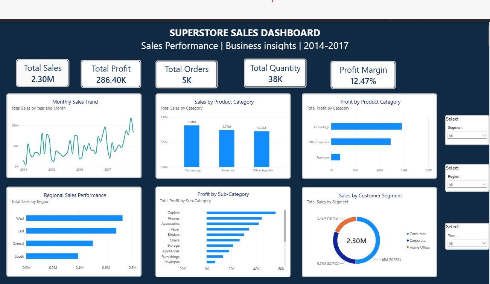

# Superstore Sales Analysis

## About the Project

I started this project to explore retail sales data and understand how a business performs using data.

The dataset contains 9,994 sales records from 2014 to 2017. I used Python for data cleaning and exploratory data analysis, and MySQL to investigate different business questions.

My main focus was to understand which products and regions generate more sales, where the business is making losses, and how discounts are related to profitability.

## Tools I Used

* Python
* Pandas
* NumPy
* Matplotlib
* Seaborn
* Jupyter Notebook
* MySQL

## Project Workflow

1. Data understanding
2. Data cleaning and preprocessing
3. Exploratory Data Analysis (EDA)
4. Business insights using Python
5. SQL analysis using MySQL

## Business Questions

During the SQL analysis, I explored questions such as:

* What are the overall sales and profit?
* Which product category performs best?
* Which region generates the highest sales?
* Which customer segment contributes the most revenue?
* Which subcategories are making losses?
* Who are the top 10 customers based on sales?
* Which products generate the highest sales?
* Which months have the highest sales?
* How has business performance changed over the years?
* How are discounts associated with profitability?
* Which states generate the highest sales and profit?

## Key Findings

* Technology generated the highest sales and profit among the three product categories.
* Furniture had good sales but a much lower profit margin than Technology and Office Supplies.
* The West region recorded the highest sales and profit.
* Consumer customers contributed the highest overall sales.
* Tables recorded the highest loss among all subcategories.
* Higher discount levels were generally associated with lower profitability.
* California recorded the highest sales among the states.

## Project Structure

`text
Sales-performance-analysis/
│
├── data/
│   └── Superstore_Cleaned.csv
│
├── notebooks/
│   └── 01_sales_data_exploration.ipynb
│
├── sql/
│   ├── superstore_analysis.sql
│   └── SQL_Business_Insights.md
│
└── README.md

## What I Learned

Through this project, I got practical experience in cleaning data, exploring datasets, writing SQL queries, and interpreting business results.

It also helped me understand how to approach business questions using data instead of just looking at numbers.

**Project:** Superstore Sales Analysis
**Domain:** Retail Analytics

Project Visualisations

 1. Sales by Category
[Sales by Category](images/sales_by_category.png)

 2. Profit by Category
[Profit by Category](images/profit_by_category.png)

 3. Sales by Region
[Sales by Region](images/sales_by_region.png)

## Power BI Dashboard

Explore the interactive Superstore Sales Dashboard created using Power BI.

[Download Power BI Dashboard](powerbi/Superstore_Sales_Dashboard.pbix)
